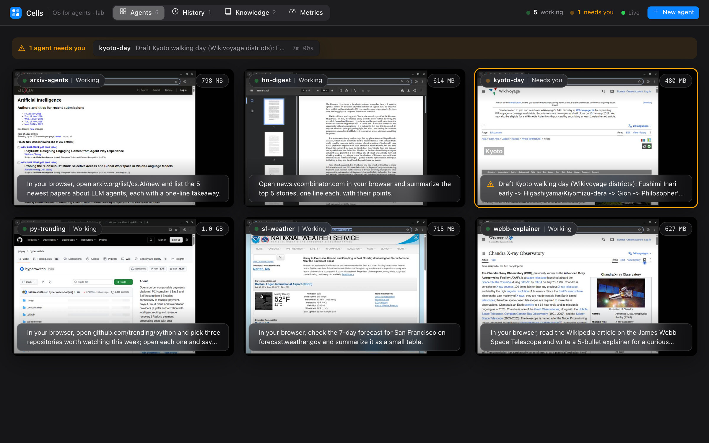
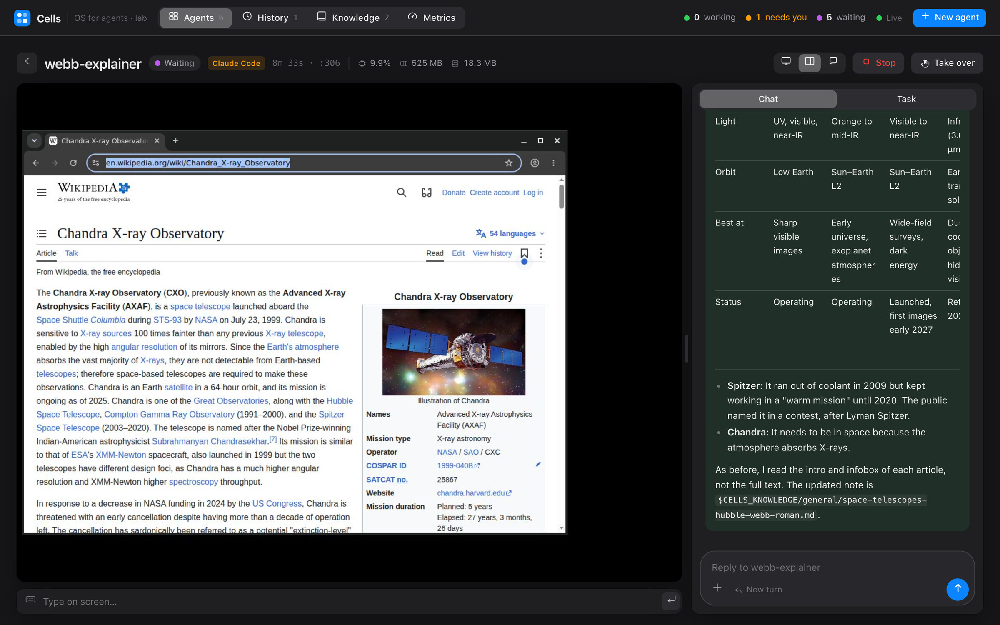
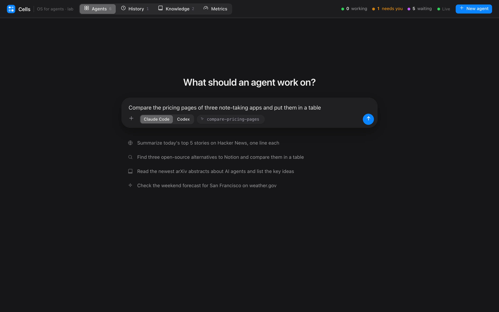
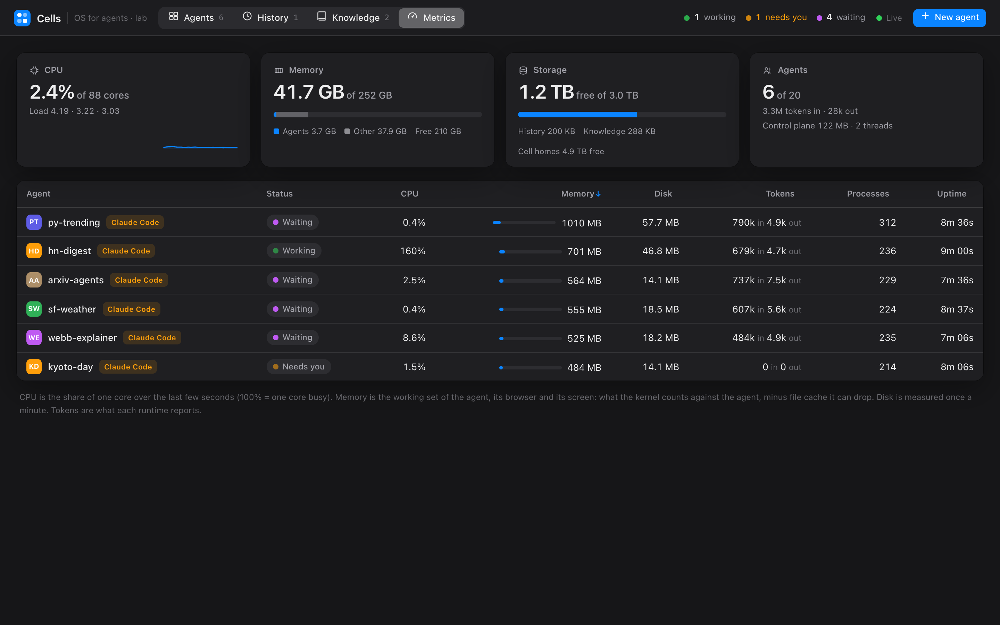
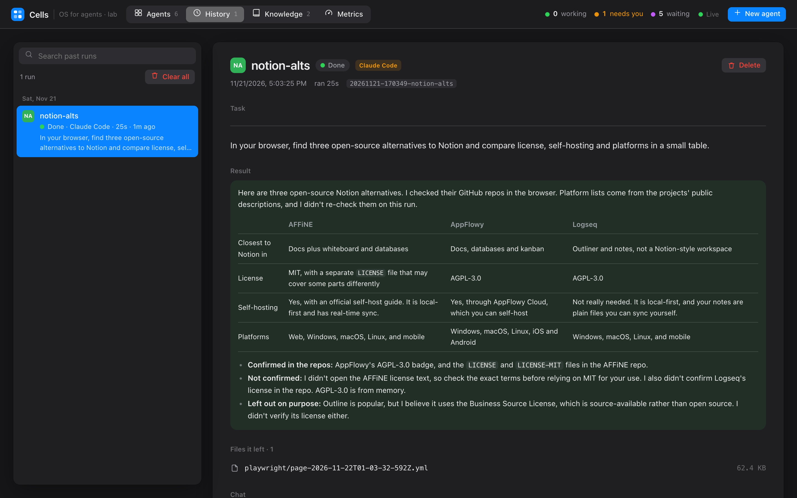
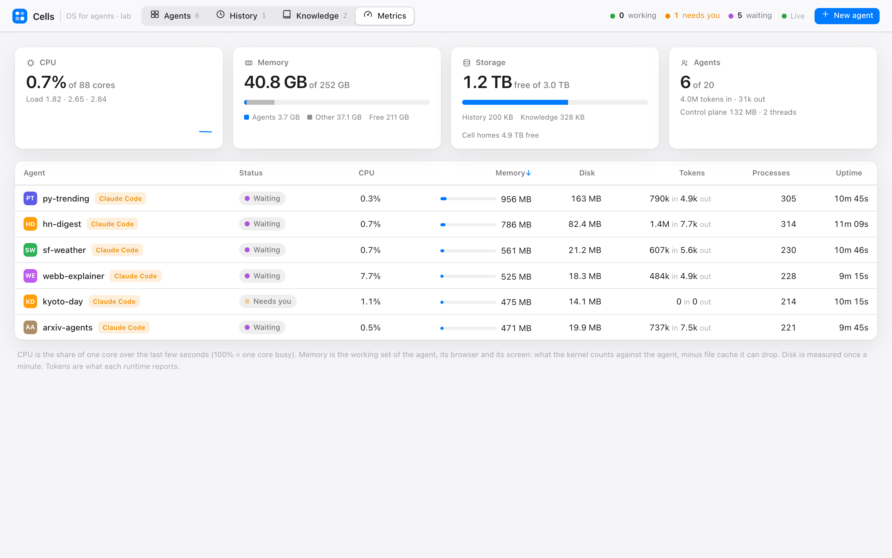
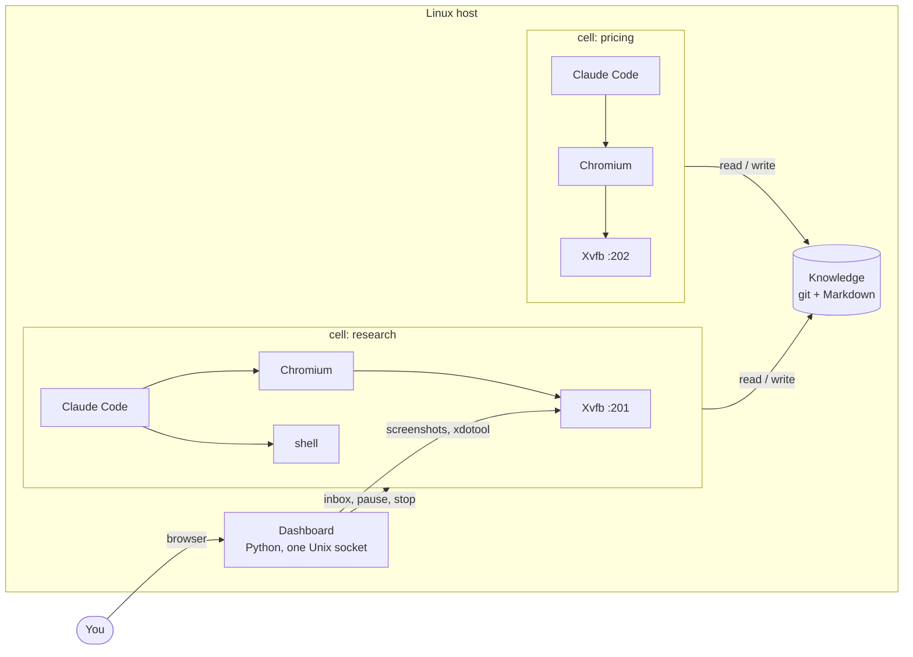

<div align="center">


# Cells

**The OS for AI agents.**<br>
Run a fleet of Claude Code and Codex agents, each in its own sandboxed Linux desktop with a screen, a browser and a shell.<br>
Watch them all live, take over any screen, chat with them, and let them share what they learn.

[](https://github.com/Ninad-Chaudhari/cells/actions/workflows/test.yml)


</div>

## Why

Computer-use agents need a computer, and running more than one on the same desktop means they fight over the mouse, the tabs and the files. Cells gives every agent its own isolated desktop (a *cell*) and gives you one control plane over all of them: a wall of live screens, a chat with each agent, a button to take over, and a shared memory they all write to.

## Features

- **Claude Code or Codex.** Pick the runtime per agent. Both get the same desktop, browser, chat, help requests and knowledge base.
- **Isolated cells.** Each agent runs in a [bubblewrap](https://github.com/containers/bubblewrap) sandbox with its own X screen, browser profile, home directory and process tree. Agents can't see each other's screens, files or tabs. Stopping a cell kills everything it started.
- **Live wall of screens.** Previews are sized to the tile and only sent when the screen changes. The agent you open streams at full resolution.
- **Take over.** Click and type on any agent's screen. The agent pauses until you hand it back.
- **Chat, with images.** Message an agent mid-task or after it's done. Paste or drop screenshots. Long chats load a page at a time.
- **Human in the loop.** Agents ask for help when they hit a login, a CAPTCHA or a decision, and their cell lights up.
- **Shared knowledge base.** A git-backed folder of Markdown that every agent reads and writes. Each agent edits its own copy; after every turn its changes become a commit under its name, merged with everyone else's, that you can browse and diff.
- **History.** Every run is archived with its chat, result and files. Search it, replay it, delete one run or all of them.
- **Metrics.** Host CPU, memory and disk, and what each agent uses (CPU, memory, disk, processes, tokens), read from the kernel's cgroup counters, not estimated. Each agent has a memory cap and a process cap.
- **Small.** A standard-library Python server and plain JavaScript. No Docker, no database, no build step, no root at runtime.

| Live screens | One agent: screen and chat |
|---|---|
|  |  |
| **Launch from the browser** | **Metrics** |
|  |  |
| **History** | **Light and dark** |
|  |  |

## Quick start

On a Linux machine with systemd (Ubuntu 22.04+, Debian 12+, Fedora 39+) and Node.js 18+:

```bash
git clone https://github.com/Ninad-Chaudhari/cells.git && cd cells
./install.sh                 # add --with-codex for Codex, --with-chromium if Chrome isn't installed
claude setup-token           # then paste the token into:
cell auth claude             # and for Codex: cell auth codex (an OpenAI API key)
cell up research "Summarize the top stories on Hacker News"
cell up coder "Find three open-source alternatives to Notion" --runtime codex
```

The installer checks your packages (and offers to install what's missing), puts its Node pieces under `~/cells/opt`, starts the dashboard as a user service and runs `cell doctor`. Run it again any time to update.

Open the dashboard from your laptop through SSH. It listens on a private Unix socket, not a port:

```bash
ssh -N -L 6080:/home/you/cells/run/dash.sock you@your-server
```

Then visit <http://localhost:6080>, press **N** and describe a task.

## How it works



- `cell up` starts an Xvfb screen and a window manager, then the agent's runtime (Claude Code or Codex) inside bubblewrap, as systemd user units with memory and process caps. The sandbox sees the host read-only, its own home, its own screen, and nothing of yours. Its browser is driven through [Playwright MCP](https://github.com/microsoft/playwright-mcp).
- A small supervisor (`agent/`) runs the turns. One driver per runtime writes that runtime's config and speaks its protocol: a long-lived `claude -p` stream for Claude Code, one `codex exec --json` per turn (resuming the same thread) for Codex.
- Your messages go into the cell's inbox. A PostToolUse hook (both runtimes have one) hands them to the agent after its current step, or they start a new turn if it has finished.
- `cell down` stops the unit (every process the agent started goes with it), archives the run to `~/cells/history` and frees the screen.

## Commands

| | |
|---|---|
| `cell up NAME "TASK" [--runtime codex]` | start an agent |
| `cell say NAME "MESSAGE" [IMAGE...]` | message it, with images |
| `cell ls` | list running agents |
| `cell down NAME` | stop it and archive the run |
| `cell history [NAME]` · `history rm ID` · `history clear --yes` | look at or delete past runs |
| `cell auth claude` · `cell auth codex` | save a credential (typed hidden) |
| `cell doctor` | check the install |

## Configuration

`~/.config/cells/config` is a shell file. Everything is optional:

| Setting | Default | |
|---|---|---|
| `CELLS_MAX` | `20` | agents working at once |
| `CELLS_OWNER` | `the operator` | how agents address you |
| `CELLS_RUNTIME` | `claude` | runtime for new agents: `claude` or `codex` |
| `CELLS_CODEX_MODEL` | Codex's default | model for Codex agents |
| `CELLS_SCREEN_SIZE` | `1280x800` | each agent's screen |
| `CELLS_MEMORY_MAX` | `8G` | memory cap per agent |
| `CELLS_CHROME_PROFILE` | empty | copy a Chrome profile into each cell so agents start signed in |
| `CELLS_HOME` | `~/cells` | state, history and the knowledge base |
| `CELLS_DASH_TCP` | empty | also serve the dashboard on TCP, e.g. `127.0.0.1:6080` |

`./install.sh --with-knowledge` adds [OpenContext](https://www.npmjs.com/package/@aicontextlab/cli) search over the knowledge base.

## Security notes

**Credentials.** `cell auth` reads the credential without echoing it and saves it in `~/cells/secrets`, readable only by you (cells refuses a file others can read). No sandbox can see that folder. A credential reaches only the agents of its own runtime, through the process environment (readable only by you), never command-line arguments (which any user on the host can list). Codex agents run with in-memory credential storage, so Codex never writes the key into the agent's home. An agent can still read its own runtime's credential from its own environment; that is inherent to running the CLI.

Agents run with their runtime's permission prompts off, so the sandbox is what keeps them in their lane:

- The host filesystem is read-only. Home directories, `~/cells` (other agents' chats, your token, the dashboard socket) and every other cell's home are hidden; a cell sees only its own home.
- Each cell has its own PID namespace and X authority cookie, so it can't signal other processes or open other cells' screens.
- A cell's own state (status, chat log, inbox) is read-only inside its sandbox. The one folder it can write, for help requests and receipts for messages, the host only reads as plain data and never writes to.
- A cell edits only its own copy of the knowledge base. The git repository lives outside every sandbox, so nothing an agent writes is ever read as git settings or hooks.
- Cells share the host's network. Anything listening on `localhost` is reachable, including the dashboard if you turn on `CELLS_DASH_TCP`.
- An X server that trusts your whole user (`xhost +SI:localuser:...`, common with xrdp) is reachable too. Run Cells under a dedicated user if that matters.

## Troubleshooting

- **`bwrap: setting up uid map: Permission denied`** (Ubuntu 24.04+): AppArmor blocks unprivileged user namespaces. Run `sudo sysctl -w kernel.apparmor_restrict_unprivileged_userns=0`, or give `bwrap` an AppArmor profile.
- **Browser won't start:** run `cell doctor`. Playwright's Chromium may need system libraries: `sudo ~/cells/opt/playwright-mcp/node_modules/.bin/playwright install-deps chromium`.
- **Agents stop when you log out:** `sudo loginctl enable-linger $USER`.

## Development

```bash
python3 -m unittest discover -s tests -t tests
```

The server is in `server/`, the UI in `web/` (no build), and the cell lifecycle in `bin/`.

## License

[MIT](LICENSE)
